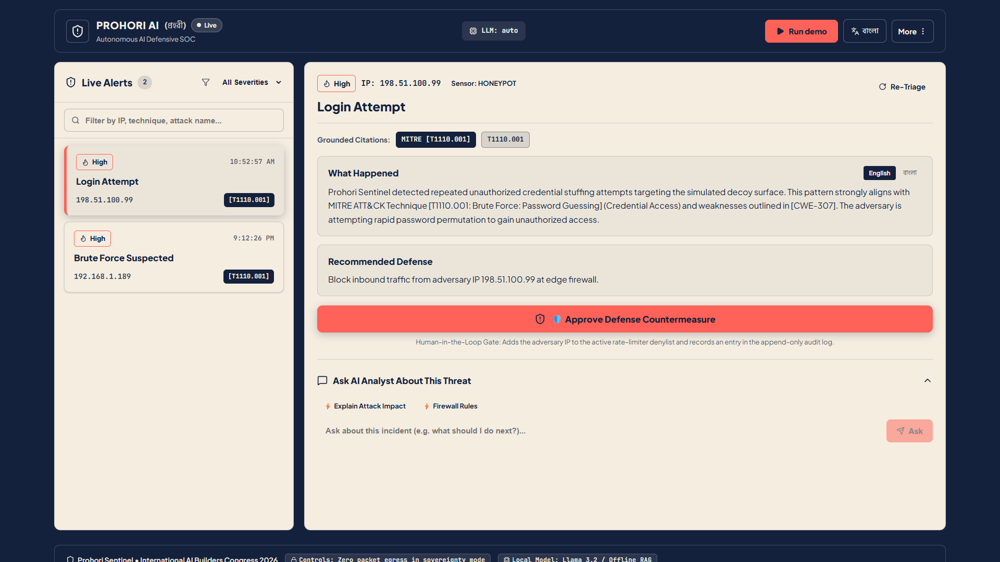
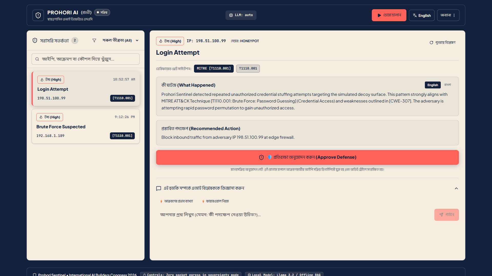

# Prohori AI ("প্রহরী") — Self-Hostable, Bilingual AI SOC Analyst

**Built by Team Orionids · International AI Builders Congress 2026 · Track: InfraSphere AI &rarr; SecureAI**

[](https://prohori-ai.vercel.app)
[](https://dashboard.render.com/blueprints/exs-dbrh0kec6qcc73dstli0)
[](#6-strict-9010-color-discipline--design-system)
[](#8-testing-verification--code-quality)
[](#3-key-technical-differentiators--innovations)
[](#3-key-technical-differentiators--innovations)

> **Prohori (প্রহরী = sentinel / guardian)** is an autonomous, self-hostable, bilingual (Bangla + English) AI SOC analyst built to protect institutions that cannot afford a dedicated 24/7 security operations center.
> Three lightweight defensive lab sensors feed a unified event ingestion bus, where an **AI SOC Analyst core** autonomously triages telemetry, correlates attack campaigns, and explains threats in plain English and native Bengali (বাংলা).
> In default sovereign mode (Ollama / Llama 3.2 or deterministic offline RAG), all telemetry remains 100% on-premises — ensuring sensitive infrastructure security logs **never leave the organization**.

---

## ⚡ Try It Right Now (60-Second Interactive Guided Tour)

You can experience the complete Prohori AI detection, triage, and mitigation workflow immediately in your browser — **zero installation, zero terminal commands, zero setup required**:

👉 **[Launch Live Operator Console (prohori-ai.vercel.app)](https://prohori-ai.vercel.app)**

```
 ┌────────────────────────────────────────────────────────────────────────────────────────┐
 │                              60-SECOND EVALUATION WORKFLOW                             │
 ├────────────────────────────────────────────────────────────────────────────────────────┤
 │ 1. Ingest Attacks  👉 Click "Run demo" in the top header. Watch live threats stream in.│
 │ 2. Inspect Triage  👉 Click "Brute Force Suspected (192.168.1.189)" in the alert list. │
 │ 3. Ask AI Analyst  👉 Click the "Firewall commands" chip inside the threat chat panel. │
 │ 4. Verify Commands 👉 See instant iptables/nftables firewall rules generated for the IP│
 │ 5. Approve Defense 👉 Click "Approve Defense Countermeasure" (Human-in-the-Loop gate). │
 │ 6. Regional Parity 👉 Click "বাংলা" in the header to view the full interface in Bengali│
 │ 7. Audit Trail     👉 Click "..." in header → "Audit Log" to verify the immutable log. │
 └────────────────────────────────────────────────────────────────────────────────────────┘
```



---

## 🧭 Master Documentation & Repository Index

Everything about Prohori AI — from clean PC setup to deep engineering architecture, deployment topology, and pitch materials — is comprehensively documented:

| Document / Asset | Description | Direct Link |
|---|---|---|
| **Complete Engineering Manual** | **All-in-one manual: Project details, history, setup, testing & deployment** | [`docs/COMPLETE_DOCUMENTATION.md`](docs/COMPLETE_DOCUMENTATION.md) |
| **How to Test Locally (Clean PC)** | **Step-by-step beginner guide to clone, run, and test on any clean computer** | [`docs/HOW_TO_TEST_LOCALLY.md`](docs/HOW_TO_TEST_LOCALLY.md) |
| **Development Log & Engineering History** | **Complete chronological record of all implementation phases, fixes, and decisions** | [`docs/DEVELOPMENT_LOG.md`](docs/DEVELOPMENT_LOG.md) |
| **Deployment & Cloud Hosting Guide** | Render Blueprint (`exs-dbrh0kec6qcc73dstli0`), Vercel, and Docker setup | [`docs/DEPLOYMENT.md`](docs/DEPLOYMENT.md) |
| **Strict 90/10 Design System & Palette** | Mathematical Navy/Cream/Coral tokens, WCAG AAA ratios, and automated linters | [`docs/DESIGN_SYSTEM.md`](docs/DESIGN_SYSTEM.md) |
| **Project Summary & Master Report** | Complete technical report, benchmark results, and system reproducibility | [`docs/PROJECT_SUMMARY.md`](docs/PROJECT_SUMMARY.md) |
| **Judge Q&A Defense Guide** | Grounded technical answers to the 8 toughest hackathon judge questions | [`docs/JUDGE_QA.md`](docs/JUDGE_QA.md) |
| **Bengali Parity & Translation Review** | Native Bengali terminology audit, security glossaries, and UI strings | [`docs/BANGLA_REVIEW.md`](docs/BANGLA_REVIEW.md) |
| **Pitch Deck (Markdown Presentation)** | Official 8-slide presentation deck calibrated to measured live demo timings | [`docs/PITCH_DECK.md`](docs/PITCH_DECK.md) |
| **Pitch Deck (PowerPoint PPTX)** | 16:9 widescreen presentation deck with embedded high-contrast QR code | [`docs/Prohori_AI_Pitch_Deck.pptx`](docs/Prohori_AI_Pitch_Deck.pptx) |
| **Demo Video & Pitch Script** | 3-minute pitch script (90% AI core focus) + 75s backup recording protocol | [`docs/DEMO_VIDEO_SCRIPT.md`](docs/DEMO_VIDEO_SCRIPT.md) |
| **Start Here (10-Minute Checklist)** | 4-step actionable checklist to finalize team submission and review | [`docs/START_HERE.md`](docs/START_HERE.md) |
| **LinkedIn & Social Media Draft** | Ready-to-publish announcement, community retrospectives, and media checklist | [`docs/LINKEDIN_POST.md`](docs/LINKEDIN_POST.md) |
| **Repository QR Code** | High-contrast QR code for instant mobile deck-to-repo access | [`docs/assets/repo_qr_code.png`](docs/assets/repo_qr_code.png) |

---

## 1. The Problem & Why Prohori AI Matters

Modern organizations face relentless cyberattacks, but conventional defense solutions fail emerging-economy institutions:

```
  ┌─────────────────────────────────┐       ┌─────────────────────────────────┐
  │  THE ENTERPRISE REALITY ($$$)   │  vs   │  THE PROHORI AI REALITY (FREE)  │
  ├─────────────────────────────────┤       ├─────────────────────────────────┤
  │ • Splunk/Sentinel: $50k-$250k/yr│       │ • 100% Free & Open Source       │
  │ • Requires dedicated 24/7 team  │       │ • Autonomous AI Analyst built-in│
  │ • Mandatory US/EU cloud upload  │       │ • 100% On-Premises Air-Gapped   │
  │ • Cryptic English-only alerts   │       │ • Bilingual English & বাংলা     │
  │ • High false-positive fatigue   │       │ • MITRE-grounded with HITL gate │
  └─────────────────────────────────┘       └─────────────────────────────────┘
```

1. **The Cost Barrier**: Regional hospitals, commercial bank branches, academic universities, and RMG manufacturing plants cannot budget \$100,000+ annually for enterprise SIEM subscriptions or maintain full-time Tier-1/Tier-2 SOC analysts.
2. **The Data Sovereignty Wall**: Strict national regulations and compliance mandates prohibit streaming internal authentication logs, network telemetry, and employee credentials to external multi-tenant cloud APIs.
3. **The Language & Skill Gap**: Most security tooling presents complex, English-only regex logs. Night-shift IT staff in Bangladesh and regional hubs need intuitive, plain-language threat narratives in both English and native Bengali (বাংলা) to make urgent, accurate containment decisions.

**Prohori AI solves all three**: It is free, self-hostable on standard commodity hardware, runs 100% air-gapped without internet, and explains complex cyber threats in clear, accessible language.

---

## 2. End-to-End System Architecture

```
                    ┌──────────────── DEFENSIVE LAB SENSORS ────────────────┐
                    │                                                       │
             Asset Discovery       Deception Sensor       API Abuse Guard   │
             (allowlisted scan)    (simulated honeypot)   (rate limiter)    │
             [Port 8083]           [Port 8081]            [Port 8082]       │
                    │                     │                      │          │
                    └──────────┬──────────┴───────────┬──────────┘          │
                               ▼                      ▼                     │
                      ┌─────────────────────────────────────────┐           │
                      │       EVENT INGESTION BUS (FastAPI)     │ ◄── abuse │
                      │       • Strict unified event schema     │     guard │
                      │       • PII & Credential scrubbing      │           │
                      │       • Deduplication & rate control    │           │
                      └────────────────────┬────────────────────┘           │
                                           ▼                                 │
                               Postgres + pgvector Database                 │
                               (Events + ATT&CK / CVE Store)                │
                               (Auto SQLite fallback in dev)                │
                                           │                                 │
                      ┌────────────────────▼────────────────────┐           │
                      │        AI SOC ANALYST (Core Engine)     │           │
                      │   • Dual-Engine: RAG (<50ms) + Neural   │           │
                      │   • Correlation Agent (Kill Chain)      │           │
                      │   • Grounded RAG (MITRE ATT&CK / CVE)   │           │
                      │   • Bilingual Narrator (English & বাংলা)│           │
                      │   • Threat Chatbot (Firewall Gen)       │           │
                      │   • Human-in-the-Loop Countermeasures   │           │
                      │   • 100% On-Premises Data Sovereignty   │           │
                      └────────────────────┬────────────────────┘           │
                                           ▼                                 │
                         WebSocket /stream │ HTTP REST                      │
                                           ▼                                 │
                             OPERATOR CONSOLE (React 19 + Vite)             │
                             • Strict 90/10 Palette (Navy/Cream/Coral)      │
                             • 2-column layout (5-second comprehension)     │
                             • Live alert stream with severity badges       │
                             • Grounded intelligence panel (EN / বাংলা)     │
                             • Interactive Threat Chatbot with chips        │
                             • One-click HITL "Approve Defense" action      │
                             • Append-only immutable audit trail drawer     │
```

---

## 3. Key Technical Differentiators & Innovations

### 1. Dual-Engine Triage Architecture (Speed + Depth)
- **Fast Deterministic RAG (Sub-50ms)**: Provides instant severity scoring, MITRE ATT&CK technique mapping (`T1110.001`, `T1499.002`, `T1595.002`), and immediate defensive recommendations in **32.03 ms median latency**. Ingestion is never blocked.
- **Deep Neural Reasoning (Background LLM)**: Powered by local Ollama (`llama3.2`) on standard CPU, generating rich multi-paragraph incident analyses and remediation protocols without cloud dependency.
- **Optional Cloud Acceleration**: Supports Google Gemini (`gemini-1.5-flash`) and Groq (`llama-3.3-70b-versatile`) when sovereignty mode is toggled off for high-throughput cloud environments.

### 2. National Data Sovereignty & Zero Cloud Egress
- In default **Bangladesh On-Premises Sovereign Mode**, zero bytes leave the local host (`127.0.0.1`).
- All MITRE ATT&CK STIX documents, CVE records, vector embeddings, and LLM reasoning run 100% air-gapped on the local machine.
- Mandatory PII scrubbing scrubs passwords, API keys, JWT bearer tokens, and employee emails *before* logs reach any model or database.

### 3. Native Bilingual Bengali (বাংলা) & English Parity
- Rather than superficial machine translation, Prohori AI features a dedicated bilingual security narrator trained on standardized cybersecurity terminology.
- Instantly switch between English and native Bengali (`বাংলা`) with a single click. Every incident explanation, threat context, and remediation step is natively articulated in both languages.



### 4. Interactive Threat Chatbot & Firewall Generation
- The built-in **"Ask AI Analyst"** interface enables operators to query alerts in natural language.
- Context-aware intent parsing recognizes operator queries and generates actionable firewall commands:
  - **"Firewall commands"**: Immediately outputs production-ready `iptables -A INPUT -s <IP> -j DROP` and `nft add rule ip filter input ip saddr <IP> drop` rules.
  - **"Primary vector?"**: Explains the exact entry point (e.g., simulated admin honeypot login or brute force rate limit trip).
  - **"Insider or external?"**: Automatically performs RFC 1918 private IP range verification (`10.0.0.0/8`, `172.16.0.0/12`, `192.168.0.0/16`) to classify whether the attack originated inside or outside the organization.

### 5. Human-in-the-Loop (HITL) Containment Gate & Audit Trail
- AI never autonomously blocks network traffic without human oversight.
- The **"Approve Defense Countermeasure"** button acts as a formal gatekeeper:
  1. Operator reviews AI recommendation and verified MITRE citations.
  2. Clicking "Approve" adds the attacker IP to the active API Abuse Guard denylist and simulates perimeter firewall enforcement.
  3. The decision, model version, timestamp, and justification are permanently committed to an **append-only, immutable audit trail** (`audit_logs` table) for forensic compliance.

### 6. Trio of Defensive Lab Sensors
- **Deception Honeypot (Port 8081)**: Lightweight decoy web service exposing fake login (`/auth/login`) and sensitive paths (`/.env`, `/wp-login.php`). Captures attacker reconnaissance without executing arbitrary code or touching host files.
- **API Abuse Guard (Port 8082)**: High-performance reverse proxy implementing sliding token-bucket rate limiting (warn &rarr; temp block &rarr; extended block) returning HTTP 429.
- **Asset Discovery Sensor (Port 8083)**: Network reconnaissance sensor that checks local infrastructure for unpatched CVEs, strictly enforcing target CIDR allowlists with HTTP 403.

---

## 4. Repository Directory & Architecture Map

This codebase is structured with clear separation of concerns across microservices, AI core, defensive sensors, and frontend console:

```
prohori-ai/
├── api/                             # Central Event Ingestion Bus & REST API (FastAPI)
│   ├── app/
│   │   ├── main.py                  # API entrypoint, routes, CORS, WebSocket /stream & discovery
│   │   ├── database.py              # Async SQLAlchemy engine (Postgres pgvector with SQLite fallback)
│   │   ├── models.py                # Database schemas (events, incidents, audit_logs, knowledge)
│   │   └── scrubber.py              # PII and credential redaction engine (passwords, tokens, keys)
│   └── tests/                       # Pytest test suite for API endpoints and event ingestion
│
├── analyst/                         # AI SOC Analyst Core Intelligence Engine
│   ├── core/
│   │   ├── triage.py                # Dual-engine triage agent (deterministic RAG + neural LLM)
│   │   ├── correlator.py            # Kill-chain correlation agent aggregating events into incidents
│   │   ├── rag.py                   # Grounded retrieval-augmented generation over STIX & CVEs
│   │   └── narrator.py              # Bilingual narrator generating English and native Bengali text
│   ├── llm/
│   │   ├── provider.py              # Unified LLM interface (Ollama, Gemini, Groq, deterministic)
│   │   ├── ollama_client.py         # Local Ollama client (Llama 3.2 on CPU, 60m weight pinning)
│   │   └── cloud_clients.py         # Google Gemini & Groq cloud API adapters
│   └── tests/                       # Unit tests for triage, correlation, and bilingual narration
│
├── sensors/                         # Lightweight Defensive Lab Sensors
│   ├── deception/                   # Simulated Honeypot Web Service (Port 8081)
│   │   ├── main.py                  # Decoy endpoints (/auth/login, /.env) trapping recon probes
│   │   └── tests/                   # Tests verifying decoy containment and telemetry dispatch
│   ├── ratelimiter/                 # API Abuse Guard Reverse Proxy (Port 8082)
│   │   ├── main.py                  # Token-bucket sliding-window rate limiter & active IP denylist
│   │   └── tests/                   # Tests verifying progressive HTTP 429 rate limiting
│   └── discovery/                   # Network Reconnaissance & Port Scanner (Port 8083)
│       ├── main.py                  # Asset discovery sensor strictly guarded by target allowlist
│       └── tests/                   # Tests verifying HTTP 403 on non-allowlisted scanning
│
├── web/                             # Operator Web Console (React 19 + TypeScript + Vite)
│   ├── src/
│   │   ├── App.tsx                  # Main console coordinator, state management & API polling
│   │   ├── App.css / index.css      # Strict 90/10 CSS custom property tokens and typography
│   │   ├── components/
│   │   │   ├── Header.tsx           # Navigation, language switch (EN/BN), demo trigger, "..." menu
│   │   │   ├── AlertList.tsx        # Real-time incoming threat feed with severity badges
│   │   │   ├── SelectedAlertPanel.tsx # Threat narrative, MITRE badges, recommended defense & HITL gate
│   │   │   ├── AskAnalyst.tsx       # Interactive Threat Chatbot with quick-action chips
│   │   │   ├── AuditLogDrawer.tsx   # Append-only immutable audit trail inspection drawer
│   │   │   └── PitchDeckModal.tsx   # Built-in 8-slide pitch presentation modal
│   │   └── utils/
│   │       ├── alertUtils.ts        # Threat parsing and severity badge formatting
│   │       └── analystFallback.ts   # Client-side offline RAG engine for zero-network resilience
│   └── package.json                 # Web console dependencies
│
├── knowledge/                       # Cybersecurity Threat Intelligence Knowledge Base
│   ├── stix/                        # Pre-seeded STIX 2.1 MITRE ATT&CK techniques (T1110, T1499, etc.)
│   ├── cve/                         # Pre-seeded NIST NVD CVE records and vulnerability advisories
│   └── ingest.py                    # Knowledge ingestion and vector embedding script
│
├── docs/                            # Comprehensive Project Documentation & Presentation Materials
│   ├── HOW_TO_TEST_LOCALLY.md       # Step-by-step local testing guide for clean computers
│   ├── DEVELOPMENT_LOG.md           # Exhaustive chronological engineering record of all sessions
│   ├── DEPLOYMENT.md                # Hosting topology, Render blueprint, endpoints, and env vars
│   ├── DESIGN_SYSTEM.md             # Strict 90/10 design system, WCAG AAA contrast, and token specs
│   ├── PROJECT_SUMMARY.md           # Master project report and technical summary
│   ├── JUDGE_QA.md                  # Grounded answers to the 8 toughest hackathon judge questions
│   ├── BANGLA_REVIEW.md             # Bengali cybersecurity terminology review and glossaries
│   ├── PITCH_DECK.md                # Official 8-slide presentation deck calibrated to demo timings
│   ├── Prohori_AI_Pitch_Deck.pptx   # 16:9 widescreen presentation deck with embedded QR code
│   └── screenshots/                 # Multi-resolution verified screenshots (before and after)
│
├── infra/                           # Infrastructure-as-Code & Container Orchestration
│   └── docker-compose.yml           # Production multi-container spec (Postgres+pgvector, API, Sensors, Web)
│
├── scripts/                         # Automation, Verification & Linters
│   ├── run_all.ps1                  # PowerShell parallel multi-service launcher
│   ├── demo_replay.py               # Deterministic 60-second 5-phase attack replay script
│   ├── demo_traffic.py              # Live HTTP attack traffic generator
│   ├── verify_e2e.py                # 15-point architectural verification test runner
│   ├── check_palette.py             # Static source code color linter (enforces 90/10 tokens)
│   ├── check_runtime_palette.py     # Playwright computed-style DOM inspector across all elements
│   └── measure_pixel_share.py       # High-precision pixel share measurement across resolutions
│
├── render.yaml                      # Declarative Render Blueprint (ID: exs-dbrh0kec6qcc73dstli0)
├── .python-version                  # Pinned Python 3.13.1 runtime for Render builds
├── run_dev.bat                      # One-click Windows development launcher
└── requirements.txt                 # Pinned Python backend dependencies
```

---

## 5. How to Run Locally on Any PC (Step-by-Step)

> 💡 **Testing on a fresh or unfamiliar computer?** Follow our comprehensive, beginner-friendly guide:  
> 👉 [**Step-by-Step Clean PC Testing Guide (`docs/HOW_TO_TEST_LOCALLY.md`)**](docs/HOW_TO_TEST_LOCALLY.md)

### 📋 Prerequisites Check (Do this first!)
Make sure these free tools are installed on your computer:
1. **Git**: Verify by running `git --version`
2. **Python 3.11, 3.12, or 3.13**: Verify with `python --version` *(On Windows, make sure "Add Python to PATH" was checked)*
3. **Node.js 18+ & npm**: Verify with `node --version` and `npm --version`

---

### Step 1: Clone and Enter the Directory

Open your terminal (PowerShell, Command Prompt, or bash) and run:

```bash
git clone https://github.com/rahat4528/prohori-ai.git
cd prohori-ai
```

> ⚠️ **CRITICAL NOTE**: You **MUST** run all subsequent commands from inside the `prohori-ai` folder! If your terminal prompt shows `C:\Users\YourName>` instead of `C:\Users\YourName\prohori-ai>`, Python will throw `ModuleNotFoundError: No module named 'sensors'`.

---

### Step 2: Launch the Entire Platform

Choose whichever launch method you prefer:

#### ⚡ Method A: Automated One-Click Launcher (Windows — Easiest & Recommended)
Simply double-click `start_all.bat` in File Explorer, or run in terminal:
```cmd
start_all.bat
```
*(Or run `run_dev.bat`)*

**What this does automatically:**
- Checks Python and Node.js installations
- Creates `.venv` and installs all dependencies (`pip install -r requirements.txt`) if missing
- Copies `.env.example` to `.env` if missing
- Installs frontend packages (`npm install`) if missing
- Spawns all 4 microservices in clearly labeled windows (Event API on `8000`, Honeypot on `8081`, Rate Limiter on `8082`, Web Console on `3000`)
- Opens your browser to `http://localhost:3000` automatically!

---

#### ⚡ Method B: Automated PowerShell Launcher (Windows)
In PowerShell inside the `prohori-ai` directory, run:
```powershell
powershell -ExecutionPolicy Bypass -File scripts/run_all.ps1
```

---

#### 🛠️ Method C: Manual Setup & Launch (Terminal by Terminal)

If you prefer running each service manually in its own terminal:

##### 1. Initial One-Time Setup:
```powershell
# Create & activate Python virtual environment:
python -m venv .venv
.\.venv\Scripts\Activate.ps1       # Windows PowerShell (or source .venv/bin/activate on Linux/Mac)
python -m pip install --upgrade pip
pip install -r requirements.txt

# Create .env config:
copy .env.example .env             # On Linux/Mac: cp .env.example .env

# Install frontend packages:
cd web
npm install
cd ..
```

##### 2. Start the Microservices (Open 4 Terminals):

> ⚠️ **Reminder**: In **EVERY** new terminal window you open, make sure you first `cd prohori-ai` and activate `.venv`!

- **Terminal 1: Event API & AI SOC Core (Port 8000)**
  ```powershell
  cd prohori-ai
  .\.venv\Scripts\Activate.ps1
  $env:PYTHONPATH="api;."
  python -m uvicorn app.main:app --host 127.0.0.1 --port 8000 --reload
  ```

- **Terminal 2: Deception Honeypot Sensor (Port 8081)**
  ```powershell
  cd prohori-ai
  .\.venv\Scripts\Activate.ps1
  $env:PYTHONPATH="api;."
  python -m uvicorn sensors.deception.main:app --host 127.0.0.1 --port 8081 --reload
  ```

- **Terminal 3: API Abuse Guard Rate Limiter (Port 8082)**
  ```powershell
  cd prohori-ai
  .\.venv\Scripts\Activate.ps1
  $env:PYTHONPATH="api;."
  $env:UPSTREAM_URL="http://127.0.0.1:8000"
  $env:EVENT_API_URL="http://127.0.0.1:8000"
  python -m uvicorn sensors.ratelimiter.main:app --host 127.0.0.1 --port 8082 --reload
  ```

- **Terminal 4: React Operator Console (Port 3000)**
  ```powershell
  cd prohori-ai\web
  npm run dev
  ```

---

### Step 3: Open and Test in Browser

Open [**http://localhost:3000**](http://localhost:3000) in your web browser.  
Click **"Run demo"** in the top header to send live test attacks through the sensors and watch the AI SOC Analyst triage, cite MITRE techniques, and recommend defenses!

---

### ❓ Troubleshooting FAQ

| Problem | Root Cause | Solution |
|---|---|---|
| `ModuleNotFoundError: No module named 'sensors'` | Terminal is sitting in `C:\Users\YourName` instead of `prohori-ai` | Run `cd prohori-ai` and activate `.venv` before running the command, or use `start_all.bat`. |
| `uvicorn: command not found` | Virtual environment is not activated | Run `.\.venv\Scripts\Activate.ps1` (or use `.venv\Scripts\python.exe -m uvicorn ...`). |
| `Execution of scripts is disabled on this system` | Windows PowerShell execution policy restriction | Run `Set-ExecutionPolicy -Scope Process -ExecutionPolicy Bypass` or run `start_all.bat`. |
| Port already in use (`8000` or `3000`) | Previous process is still running | Open Task Manager and end python/node processes, or run `netstat -ano \| findstr :8000` and kill the PID. |
Navigate to [**http://localhost:3000**](http://localhost:3000) in your web browser. Click **"Run demo"** in the top navigation bar to populate live incoming attack telemetry!

---

## 6. Strict 90/10 Color Discipline & Design System

Prohori AI implements a mathematically disciplined **90/10 color system** built to minimize cognitive load during high-stress security operations:

| Role | Color Name | Hex Code | RGB | Approved Purpose & Placement |
|---|---|---|---|---|
| **Primary Dominant** | **Navy** | `#14213D` | `(20, 33, 61)` | Page background, header, dark structural panels, text on Cream cards |
| **Secondary Dominant** | **Cream** | `#F4EDE0` | `(244, 237, 224)` | Card surfaces, alert items, analyst panel, modals, text on Navy areas |
| **Accent (~10%)** | **Coral** | `#FF6258` | `(255, 98, 88)` | Primary CTAs (Run demo, Approve Defense), active alert indicator, key highlights |

```
 ┌────────────────────────────────────────────────────────────────────────┐
 │                      EMPIRICAL PIXEL SHARE BALANCE                     │
 ├────────────────────────────────────────────────────────────────────────┤
 │  Navy + Cream (Dominant 90% Surface Area)      ████████████  96.71%    │
 │  Coral (Actionable 10% Accent Area)            █              3.29%    │
 └────────────────────────────────────────────────────────────────────────┘
```

- **WCAG AAA Contrast**: Navy on Cream delivers an extraordinary **13.72:1 contrast ratio** (far exceeding WCAG AAA 7.0:1 requirement). Navy on Coral achieves **5.43:1** (exceeding WCAG AA 4.5:1).
- **Zero Third-Party Font Egress**: Bundles zero Google Fonts or external CDNs; typography is rendered via local system font stacks ensuring 100% offline air-gap compliance and immediate rendering of Bengali characters.
- **Automated Palette Linters**:
  - `python scripts/check_palette.py` &rarr; Static regex scan of all TSX, CSS, and HTML files for non-token color declarations.
  - `python scripts/check_runtime_palette.py` &rarr; Playwright DOM inspector asserting every rendered element conforms to approved tokens.

For complete color tokens, alpha transparency levels, and accessibility metrics, see [`docs/DESIGN_SYSTEM.md`](docs/DESIGN_SYSTEM.md).

---

## 7. Cloud Deployment & Live Endpoints

In addition to local on-premises execution, Prohori AI is deployed across high-availability cloud platforms:

| Component | Platform | Live URL / Identifier | Status |
|---|---|---|---|
| **Operator Console** | Vercel Production | [https://prohori-ai.vercel.app](https://prohori-ai.vercel.app) | 🟢 Live |
| **Event API & AI Core** | Render Cloud Blueprint | [Blueprint: `exs-dbrh0kec6qcc73dstli0`](https://dashboard.render.com/blueprints/exs-dbrh0kec6qcc73dstli0) | 🟢 Provisioned |
| **Interactive API Docs** | FastAPI Swagger UI | `/docs` on active API host | 🟢 Active |
| **ReDoc Technical Docs** | FastAPI ReDoc | `/redoc` on active API host | 🟢 Active |
| **WebSocket Event Stream**| FastAPI WebSocket | `/stream` on active API host | 🟢 Duplex |

### Master Backend REST Endpoints (18 Endpoints)

| Method | Endpoint | Description |
|---|---|---|
| `GET` | `/` | API discovery and platform version metadata |
| `GET` | `/healthz` | System health check and database connection status (`HTTP 200`) |
| `POST` | `/events` | Ingest raw sensor telemetry with secret scrubbing and instant triage |
| `GET` | `/events` | Query historical security events with pagination and filters |
| `GET` | `/events/{id}` | Retrieve full forensic event details |
| `POST` | `/analyst/triage/{id}` | On-demand autonomous AI triage and MITRE ATT&CK technique mapping |
| `POST` | `/analyst/ask` | Natural-language security Q&A with firewall command generation |
| `POST` | `/analyst/ask/stream` | Real-time Server-Sent Events (SSE) streaming reasoning tokens |
| `GET` | `/analyst/incidents` | Query correlated attack campaigns and lifecycle states |
| `PATCH`| `/analyst/incidents/{id}/status` | Update incident lifecycle (`ACTIVE` &rarr; `CONTAINED` &rarr; `RESOLVED`) |
| `GET` | `/knowledge/{doc_id}` | Retrieve STIX 2.1 MITRE technique or NIST CVE vulnerability card |
| `GET` | `/analyst/knowledge/{doc_id}` | Contextual knowledge retrieval for operator research |
| `POST` | `/audit/approve` | Human-in-the-Loop containment approval and active firewall blocking |
| `GET` | `/audit` | Inspect immutable append-only audit trail entries |
| `GET` | `/sovereignty/status` | Query current data sovereignty mode (`BANGLADESH_ON_PREM_ONLY`) |
| `POST` | `/sovereignty/toggle` | Toggle sovereignty mode between on-premises and cloud-hybrid |
| `POST` | `/demo/reset` | Clean demo state and reseed standard forensic attack telemetry |
| `WS` | `/stream` | Duplex WebSocket stream broadcasting real-time security events |

For complete cloud configuration details, environment variables, and Docker parameters, see [`docs/DEPLOYMENT.md`](docs/DEPLOYMENT.md).

---

## 8. Testing, Verification & Code Quality

Prohori AI includes a comprehensive, verified test suite covering every layer of the application:

```bash
# 1. Run all Pytest suites (43 passed):
pytest api/tests sensors/deception/tests sensors/ratelimiter/tests analyst/tests sensors/discovery/tests -v

# 2. Run 15-point End-to-End Architectural Verification:
python scripts/verify_e2e.py

# 3. Run Static Palette Compliance Linter:
python scripts/check_palette.py

# 4. Run Frontend TypeScript & Production Build:
cd web && npm run build
```

```
============================== test session starts ==============================
collected 43 items

api/tests/test_api.py ...........                                         [ 25%]
sensors/deception/tests/test_deception.py .....                          [ 37%]
sensors/ratelimiter/tests/test_ratelimiter.py ......                      [ 51%]
analyst/tests/test_analyst.py ..............                              [ 83%]
sensors/discovery/tests/test_discovery.py .......                         [100%]

============================== 43 passed in 13.08s ==============================
```

---

## 9. Live Demo Simulation Scripts

Two automated attack simulation scripts are bundled to demonstrate the real-time detection pipeline:

1. **Deterministic 60-Second Replay Sequence**:
   ```bash
   python scripts/demo_replay.py
   ```
   Replays a realistic 5-phase intrusion campaign:  
   `Recon Probe` &rarr; `Credential Stuffing` &rarr; `Brute Force Burst` &rarr; `API Abuse Block` &rarr; `CVE Match` &rarr; `Correlated Incident (INC-2026-0001)`.

2. **Live Interactive Traffic Generator**:
   ```bash
   python scripts/demo_traffic.py
   ```
   Fires live HTTP traffic against your local honeypot and rate limiter, tripping decoy traps and generating HTTP 429 rate limit containment events.

---

## 10. Responsible AI & Defensive Ethics

Prohori AI is built exclusively for defensive security operations within authorized organizational perimeters:
- **Strict Target Allowlisting**: The discovery sensor (`sensors/discovery/main.py`) validates targets against a hardcoded subnet allowlist and strictly aborts with `HTTP 403 Forbidden` if scanning outside authorized ranges.
- **Simulated Deception**: The honeypot sensor touches zero host files, executes no arbitrary shell commands, and serves entirely static decoy responses.
- **Mandatory Human-in-the-Loop (HITL)**: Autonomous AI models are never granted unattended firewall execution privileges; containment requires explicit operator confirmation.
- **Forensic Auditability**: Every reasoning step, model provider, prompt hash, and operator approval is permanently recorded in the append-only audit log.

---

## 11. Team Orionids

Prohori AI was engineered by **Team Orionids** (Undergraduate Engineers from the **Department of Computer Science & Engineering, Daffodil International University**) for the **International AI Builders Congress 2026** (InfraSphere AI &rarr; SecureAI).

- **Institution**: Daffodil International University (DIU), Department of CSE
- **Team**: Team Orionids
- **Repository**: [https://github.com/rahat4528/prohori-ai](https://github.com/rahat4528/prohori-ai)
- **Live Console**: [https://prohori-ai.vercel.app](https://prohori-ai.vercel.app)
- **Official Documentation**: See [`docs/TEAM.md`](docs/TEAM.md), [`docs/PITCH_DECK.md`](docs/PITCH_DECK.md), and [`docs/DEVELOPMENT_LOG.md`](docs/DEVELOPMENT_LOG.md).
