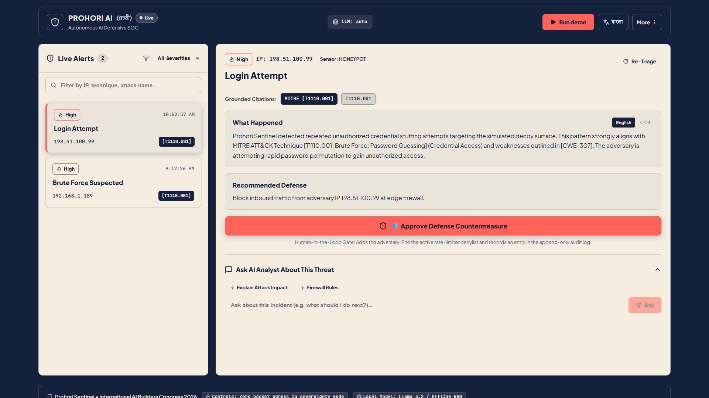
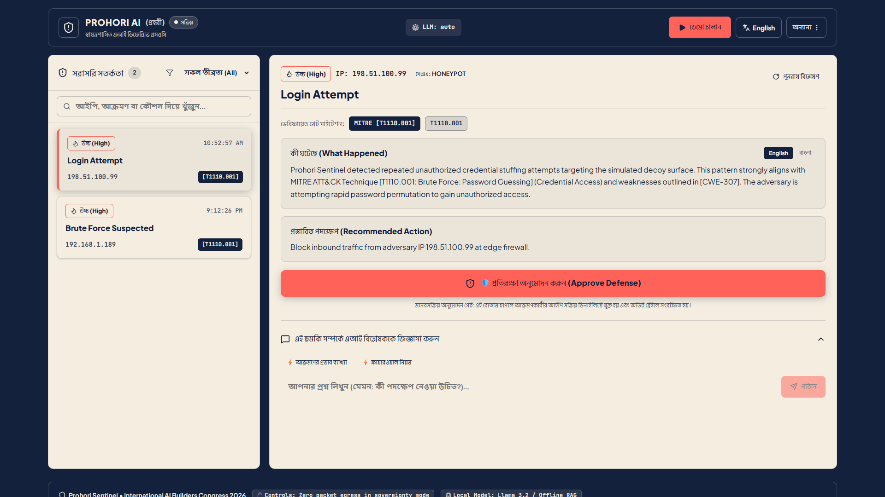

# Prohori AI ("প্রহরী") — Self-Hostable, Bilingual AI SOC Analyst

**Built by Team Orionids · International AI Builders Congress 2026 · Track: InfraSphere AI &rarr; SecureAI**

[](https://prohori-ai.vercel.app)
[](https://dashboard.render.com/blueprints/exs-dbrh0kec6qcc73dstli0)
[](#6-strict-9010-color-discipline--design-system)
[](#8-testing-verification--code-quality)
[](#3-key-technical-differentiators--innovations)
[](#3-key-technical-differentiators--innovations)

> **Prohori (প্রহরী = sentinel / guardian)** is an autonomous, self-hostable, bilingual (Bangla + English) AI SOC analyst built to protect institutions that cannot afford a dedicated 24/7 security operations center.
> Three lightweight defensive lab sensors feed a unified event ingestion bus, where an **AI SOC Analyst core** autonomously triages telemetry, correlates attack campaigns, and explains threats in plain English and native Bengali (বাংলা).
> In default sovereign mode (Ollama / Llama 3.2 or deterministic offline RAG), all telemetry remains 100% on-premises — ensuring sensitive infrastructure security logs **never leave the organization**.

---

## ⚡ Try It Right Now (60-Second Interactive Guided Tour)

You can experience the complete Prohori AI detection, triage, and mitigation workflow immediately in your browser — **zero installation, zero terminal commands, zero setup required**:

👉 **[Launch Live Operator Console (prohori-ai.vercel.app)](https://prohori-ai.vercel.app)**

```
 ┌────────────────────────────────────────────────────────────────────────────────────────┐
 │                              60-SECOND EVALUATION WORKFLOW                             │
 ├────────────────────────────────────────────────────────────────────────────────────────┤
 │ 1. Ingest Attacks  👉 Click "Run demo" in the top header. Watch live threats stream in.│
 │ 2. Inspect Triage  👉 Click "Brute Force Suspected (192.168.1.189)" in the alert list. │
 │ 3. Ask AI Analyst  👉 Click the "Firewall commands" chip inside the threat chat panel. │
 │ 4. Verify Commands 👉 See instant iptables/nftables firewall rules generated for the IP│
 │ 5. Approve Defense 👉 Click "Approve Defense Countermeasure" (Human-in-the-Loop gate). │
 │ 6. Regional Parity 👉 Click "বাংলা" in the header to view the full interface in Bengali│
 │ 7. Audit Trail     👉 Click "..." in header → "Audit Log" to verify the immutable log. │
 └────────────────────────────────────────────────────────────────────────────────────────┘
```



---

## 🧭 Master Documentation & Repository Index

Everything about Prohori AI — from clean PC setup to deep engineering architecture, deployment topology, and pitch materials — is comprehensively documented:

| Document / Asset | Description | Direct Link |
|---|---|---|
| **Complete Engineering Manual** | **All-in-one manual: Project details, history, setup, testing & deployment** | [`docs/COMPLETE_DOCUMENTATION.md`](docs/COMPLETE_DOCUMENTATION.md) |
| **How to Test Locally (Clean PC)** | **Step-by-step beginner guide to clone, run, and test on any clean computer** | [`docs/HOW_TO_TEST_LOCALLY.md`](docs/HOW_TO_TEST_LOCALLY.md) |
| **Development Log & Engineering History** | **Complete chronological record of all implementation phases, fixes, and decisions** | [`docs/DEVELOPMENT_LOG.md`](docs/DEVELOPMENT_LOG.md) |
| **Deployment & Cloud Hosting Guide** | Render Blueprint (`exs-dbrh0kec6qcc73dstli0`), Vercel, and Docker setup | [`docs/DEPLOYMENT.md`](docs/DEPLOYMENT.md) |
| **Strict 90/10 Design System & Palette** | Mathematical Navy/Cream/Coral tokens, WCAG AAA ratios, and automated linters | [`docs/DESIGN_SYSTEM.md`](docs/DESIGN_SYSTEM.md) |
| **Project Summary & Master Report** | Complete technical report, benchmark results, and system reproducibility | [`docs/PROJECT_SUMMARY.md`](docs/PROJECT_SUMMARY.md) |
| **Judge Q&A Defense Guide** | Grounded technical answers to the 8 toughest hackathon judge questions | [`docs/JUDGE_QA.md`](docs/JUDGE_QA.md) |
| **Bengali Parity & Translation Review** | Native Bengali terminology audit, security glossaries, and UI strings | [`docs/BANGLA_REVIEW.md`](docs/BANGLA_REVIEW.md) |
| **Pitch Deck (Markdown Presentation)** | Official 8-slide presentation deck calibrated to measured live demo timings | [`docs/PITCH_DECK.md`](docs/PITCH_DECK.md) |
| **Pitch Deck (PowerPoint PPTX)** | 16:9 widescreen presentation deck with embedded high-contrast QR code | [`docs/Prohori_AI_Pitch_Deck.pptx`](docs/Prohori_AI_Pitch_Deck.pptx) |
| **Demo Video & Pitch Script** | 3-minute pitch script (90% AI core focus) + 75s backup recording protocol | [`docs/DEMO_VIDEO_SCRIPT.md`](docs/DEMO_VIDEO_SCRIPT.md) |
| **Start Here (10-Minute Checklist)** | 4-step actionable checklist to finalize team submission and review | [`docs/START_HERE.md`](docs/START_HERE.md) |
| **LinkedIn & Social Media Draft** | Ready-to-publish announcement, community retrospectives, and media checklist | [`docs/LINKEDIN_POST.md`](docs/LINKEDIN_POST.md) |
| **Repository QR Code** | High-contrast QR code for instant mobile deck-to-repo access | [`docs/assets/repo_qr_code.png`](docs/assets/repo_qr_code.png) |

---

## 1. The Problem & Why Prohori AI Matters

Modern organizations face relentless cyberattacks, but conventional defense solutions fail emerging-economy institutions:

```
  ┌─────────────────────────────────┐       ┌─────────────────────────────────┐
  │  THE ENTERPRISE REALITY ($$$)   │  vs   │  THE PROHORI AI REALITY (FREE)  │
  ├─────────────────────────────────┤       ├─────────────────────────────────┤
  │ • Splunk/Sentinel: $50k-$250k/yr│       │ • 100% Free & Open Source       │
  │ • Requires dedicated 24/7 team  │       │ • Autonomous AI Analyst built-in│
  │ • Mandatory US/EU cloud upload  │       │ • 100% On-Premises Air-Gapped   │
  │ • Cryptic English-only alerts   │       │ • Bilingual English & বাংলা     │
  │ • High false-positive fatigue   │       │ • MITRE-grounded with HITL gate │
  └─────────────────────────────────┘       └─────────────────────────────────┘
```

1. **The Cost Barrier**: Regional hospitals, commercial bank branches, academic universities, and RMG manufacturing plants cannot budget \$100,000+ annually for enterprise SIEM subscriptions or maintain full-time Tier-1/Tier-2 SOC analysts.
2. **The Data Sovereignty Wall**: Strict national regulations and compliance mandates prohibit streaming internal authentication logs, network telemetry, and employee credentials to external multi-tenant cloud APIs.
3. **The Language & Skill Gap**: Most security tooling presents complex, English-only regex logs. Night-shift IT staff in Bangladesh and regional hubs need intuitive, plain-language threat narratives in both English and native Bengali (বাংলা) to make urgent, accurate containment decisions.

**Prohori AI solves all three**: It is free, self-hostable on standard commodity hardware, runs 100% air-gapped without internet, and explains complex cyber threats in clear, accessible language.

---

## 2. End-to-End System Architecture

```
                    ┌──────────────── DEFENSIVE LAB SENSORS ────────────────┐
                    │                                                       │
             Asset Discovery       Deception Sensor       API Abuse Guard   │
             (allowlisted scan)    (simulated honeypot)   (rate limiter)    │
             [Port 8083]           [Port 8081]            [Port 8082]       │
                    │                     │                      │          │
                    └──────────┬──────────┴───────────┬──────────┘          │
                               ▼                      ▼                     │
                      ┌─────────────────────────────────────────┐           │
                      │       EVENT INGESTION BUS (FastAPI)     │ ◄── abuse │
                      │       • Strict unified event schema     │     guard │
                      │       • PII & Credential scrubbing      │           │
                      │       • Deduplication & rate control    │           │
                      └────────────────────┬────────────────────┘           │
                                           ▼                                 │
                               Postgres + pgvector Database                 │
                               (Events + ATT&CK / CVE Store)                │
                               (Auto SQLite fallback in dev)                │
                                           │                                 │
                      ┌────────────────────▼────────────────────┐           │
                      │        AI SOC ANALYST (Core Engine)     │           │
                      │   • Dual-Engine: RAG (<50ms) + Neural   │           │
                      │   • Correlation Agent (Kill Chain)      │           │
                      │   • Grounded RAG (MITRE ATT&CK / CVE)   │           │
                      │   • Bilingual Narrator (English & বাংলা)│           │
                      │   • Threat Chatbot (Firewall Gen)       │           │
                      │   • Human-in-the-Loop Countermeasures   │           │
                      │   • 100% On-Premises Data Sovereignty   │           │
                      └────────────────────┬────────────────────┘           │
                                           ▼                                 │
                         WebSocket /stream │ HTTP REST                      │
                                           ▼                                 │
                             OPERATOR CONSOLE (React 19 + Vite)             │
                             • Strict 90/10 Palette (Navy/Cream/Coral)      │
                             • 2-column layout (5-second comprehension)     │
                             • Live alert stream with severity badges       │
                             • Grounded intelligence panel (EN / বাংলা)     │
                             • Interactive Threat Chatbot with chips        │
                             • One-click HITL "Approve Defense" action      │
                             • Append-only immutable audit trail drawer     │
```

---

## 3. Key Technical Differentiators & Innovations

### 1. Dual-Engine Triage Architecture (Speed + Depth)
- **Fast Deterministic RAG (Sub-50ms)**: Provides instant severity scoring, MITRE ATT&CK technique mapping (`T1110.001`, `T1499.002`, `T1595.002`), and immediate defensive recommendations in **32.03 ms median latency**. Ingestion is never blocked.
- **Deep Neural Reasoning (Background LLM)**: Powered by local Ollama (`llama3.2`) on standard CPU, generating rich multi-paragraph incident analyses and remediation protocols without cloud dependency.
- **Optional Cloud Acceleration**: Supports Google Gemini (`gemini-1.5-flash`) and Groq (`llama-3.3-70b-versatile`) when sovereignty mode is toggled off for high-throughput cloud environments.

### 2. National Data Sovereignty & Zero Cloud Egress
- In default **Bangladesh On-Premises Sovereign Mode**, zero bytes leave the local host (`127.0.0.1`).
- All MITRE ATT&CK STIX documents, CVE records, vector embeddings, and LLM reasoning run 100% air-gapped on the local machine.
- Mandatory PII scrubbing scrubs passwords, API keys, JWT bearer tokens, and employee emails *before* logs reach any model or database.

### 3. Native Bilingual Bengali (বাংলা) & English Parity
- Rather than superficial machine translation, Prohori AI features a dedicated bilingual security narrator trained on standardized cybersecurity terminology.
- Instantly switch between English and native Bengali (`বাংলা`) with a single click. Every incident explanation, threat context, and remediation step is natively articulated in both languages.



### 4. Interactive Threat Chatbot & Firewall Generation
- The built-in **"Ask AI Analyst"** interface enables operators to query alerts in natural language.
- Context-aware intent parsing recognizes operator queries and generates actionable firewall commands:
  - **"Firewall commands"**: Immediately outputs production-ready `iptables -A INPUT -s <IP> -j DROP` and `nft add rule ip filter input ip saddr <IP> drop` rules.
  - **"Primary vector?"**: Explains the exact entry point (e.g., simulated admin honeypot login or brute force rate limit trip).
  - **"Insider or external?"**: Automatically performs RFC 1918 private IP range verification (`10.0.0.0/8`, `172.16.0.0/12`, `192.168.0.0/16`) to classify whether the attack originated inside or outside the organization.

### 5. Human-in-the-Loop (HITL) Containment Gate & Audit Trail
- AI never autonomously blocks network traffic without human oversight.
- The **"Approve Defense Countermeasure"** button acts as a formal gatekeeper:
  1. Operator reviews AI recommendation and verified MITRE citations.
  2. Clicking "Approve" adds the attacker IP to the active API Abuse Guard denylist and simulates perimeter firewall enforcement.
  3. The decision, model version, timestamp, and justification are permanently committed to an **append-only, immutable audit trail** (`audit_logs` table) for forensic compliance.

### 6. Trio of Defensive Lab Sensors
- **Deception Honeypot (Port 8081)**: Lightweight decoy web service exposing fake login (`/auth/login`) and sensitive paths (`/.env`, `/wp-login.php`). Captures attacker reconnaissance without executing arbitrary code or touching host files.
- **API Abuse Guard (Port 8082)**: High-performance reverse proxy implementing sliding token-bucket rate limiting (warn &rarr; temp block &rarr; extended block) returning HTTP 429.
- **Asset Discovery Sensor (Port 8083)**: Network reconnaissance sensor that checks local infrastructure for unpatched CVEs, strictly enforcing target CIDR allowlists with HTTP 403.

---

## 4. Repository Directory & Architecture Map

This codebase is structured with clear separation of concerns across microservices, AI core, defensive sensors, and frontend console:

```
prohori-ai/
├── api/                             # Central Event Ingestion Bus & REST API (FastAPI)
│   ├── app/
│   │   ├── main.py                  # API entrypoint, routes, CORS, WebSocket /stream & discovery
│   │   ├── database.py              # Async SQLAlchemy engine (Postgres pgvector with SQLite fallback)
│   │   ├── models.py                # Database schemas (events, incidents, audit_logs, knowledge)
│   │   └── scrubber.py              # PII and credential redaction engine (passwords, tokens, keys)
│   └── tests/                       # Pytest test suite for API endpoints and event ingestion
│
├── analyst/                         # AI SOC Analyst Core Intelligence Engine
│   ├── core/
│   │   ├── triage.py                # Dual-engine triage agent (deterministic RAG + neural LLM)
│   │   ├── correlator.py            # Kill-chain correlation agent aggregating events into incidents
│   │   ├── rag.py                   # Grounded retrieval-augmented generation over STIX & CVEs
│   │   └── narrator.py              # Bilingual narrator generating English and native Bengali text
│   ├── llm/
│   │   ├── provider.py              # Unified LLM interface (Ollama, Gemini, Groq, deterministic)
│   │   ├── ollama_client.py         # Local Ollama client (Llama 3.2 on CPU, 60m weight pinning)
│   │   └── cloud_clients.py         # Google Gemini & Groq cloud API adapters
│   └── tests/                       # Unit tests for triage, correlation, and bilingual narration
│
├── sensors/                         # Lightweight Defensive Lab Sensors
│   ├── deception/                   # Simulated Honeypot Web Service (Port 8081)
│   │   ├── main.py                  # Decoy endpoints (/auth/login, /.env) trapping recon probes
│   │   └── tests/                   # Tests verifying decoy containment and telemetry dispatch
│   ├── ratelimiter/                 # API Abuse Guard Reverse Proxy (Port 8082)
│   │   ├── main.py                  # Token-bucket sliding-window rate limiter & active IP denylist
│   │   └── tests/                   # Tests verifying progressive HTTP 429 rate limiting
│   └── discovery/                   # Network Reconnaissance & Port Scanner (Port 8083)
│       ├── main.py                  # Asset discovery sensor strictly guarded by target allowlist
│       └── tests/                   # Tests verifying HTTP 403 on non-allowlisted scanning
│
├── web/                             # Operator Web Console (React 19 + TypeScript + Vite)
│   ├── src/
│   │   ├── App.tsx                  # Main console coordinator, state management & API polling
│   │   ├── App.css / index.css      # Strict 90/10 CSS custom property tokens and typography
│   │   ├── components/
│   │   │   ├── Header.tsx           # Navigation, language switch (EN/BN), demo trigger, "..." menu
│   │   │   ├── AlertList.tsx        # Real-time incoming threat feed with severity badges
│   │   │   ├── SelectedAlertPanel.tsx # Threat narrative, MITRE badges, recommended defense & HITL gate
│   │   │   ├── AskAnalyst.tsx       # Interactive Threat Chatbot with quick-action chips
│   │   │   ├── AuditLogDrawer.tsx   # Append-only immutable audit trail inspection drawer
│   │   │   └── PitchDeckModal.tsx   # Built-in 8-slide pitch presentation modal
│   │   └── utils/
│   │       ├── alertUtils.ts        # Threat parsing and severity badge formatting
│   │       └── analystFallback.ts   # Client-side offline RAG engine for zero-network resilience
│   └── package.json                 # Web console dependencies
│
├── knowledge/                       # Cybersecurity Threat Intelligence Knowledge Base
│   ├── stix/                        # Pre-seeded STIX 2.1 MITRE ATT&CK techniques (T1110, T1499, etc.)
│   ├── cve/                         # Pre-seeded NIST NVD CVE records and vulnerability advisories
│   └── ingest.py                    # Knowledge ingestion and vector embedding script
│
├── docs/                            # Comprehensive Project Documentation & Presentation Materials
│   ├── HOW_TO_TEST_LOCALLY.md       # Step-by-step local testing guide for clean computers
│   ├── DEVELOPMENT_LOG.md           # Exhaustive chronological engineering record of all sessions
│   ├── DEPLOYMENT.md                # Hosting topology, Render blueprint, endpoints, and env vars
│   ├── DESIGN_SYSTEM.md             # Strict 90/10 design system, WCAG AAA contrast, and token specs
│   ├── PROJECT_SUMMARY.md           # Master project report and technical summary
│   ├── JUDGE_QA.md                  # Grounded answers to the 8 toughest hackathon judge questions
│   ├── BANGLA_REVIEW.md             # Bengali cybersecurity terminology review and glossaries
│   ├── PITCH_DECK.md                # Official 8-slide presentation deck calibrated to demo timings
│   ├── Prohori_AI_Pitch_Deck.pptx   # 16:9 widescreen presentation deck with embedded QR code
│   └── screenshots/                 # Multi-resolution verified screenshots (before and after)
│
├── infra/                           # Infrastructure-as-Code & Container Orchestration
│   └── docker-compose.yml           # Production multi-container spec (Postgres+pgvector, API, Sensors, Web)
│
├── scripts/                         # Automation, Verification & Linters
│   ├── run_all.ps1                  # PowerShell parallel multi-service launcher
│   ├── demo_replay.py               # Deterministic 60-second 5-phase attack replay script
│   ├── demo_traffic.py              # Live HTTP attack traffic generator
│   ├── verify_e2e.py                # 15-point architectural verification test runner
│   ├── check_palette.py             # Static source code color linter (enforces 90/10 tokens)
│   ├── check_runtime_palette.py     # Playwright computed-style DOM inspector across all elements
│   └── measure_pixel_share.py       # High-precision pixel share measurement across resolutions
│
├── render.yaml                      # Declarative Render Blueprint (ID: exs-dbrh0kec6qcc73dstli0)
├── .python-version                  # Pinned Python 3.13.1 runtime for Render builds
├── run_dev.bat                      # One-click Windows development launcher
└── requirements.txt                 # Pinned Python backend dependencies
```

---

## 5. Setup & Local Deployment Guide

> 💡 **Testing on a fresh or unfamiliar computer?** Follow our comprehensive, beginner-friendly guide:  
> 👉 [**Step-by-Step Clean PC Testing Guide (`docs/HOW_TO_TEST_LOCALLY.md`)**](docs/HOW_TO_TEST_LOCALLY.md)

### 🚀 Universal 1-Click Launch (Runs from ANY folder in PowerShell)

If you just want to run everything with a single copy-paste, run this in PowerShell:

```powershell
if (Test-Path ".git") { git pull } elseif (Test-Path "prohori-ai\.git") { cd prohori-ai; git pull } else { git clone https://github.com/rahat4528/prohori-ai.git; cd prohori-ai }; .\start_all.bat
```

> 💡 **What this line does automatically:**
> - Detects whether you are already inside `prohori-ai`, in the parent directory (`C:\Users\YourName`), or starting on a clean computer.
> - Automatically clones or pulls the latest code.
> - Enters the project root folder and executes `start_all.bat` seamlessly.

---

### 1. System Requirements

#### Supported Operating Systems
- **Windows**: Windows 10 or Windows 11 (64-bit) — PowerShell 5.1+, Windows Terminal, or Command Prompt (CMD).
- **macOS**: macOS 12 (Monterey), 13 (Ventura), 14 (Sonoma), 15 (Sequoia) — Apple Silicon (M1/M2/M3/M4) or Intel.
- **Linux**: Ubuntu 20.04+, Debian 11+, Fedora, Arch Linux, or any modern systemd/kernel 5.4+ distribution.

#### Minimum vs. Recommended Hardware Requirements

| Component | Minimum Specification (Standard / Deterministic Mode) | Recommended Specification (Local Ollama / Llama 3.2 LLM) |
|---|---|---|
| **Processor (CPU)** | 2 Cores (Intel Core i3 / AMD Ryzen 3 or equivalent) | 4+ Cores (Intel Core i5/i7 / AMD Ryzen 5/7 / Apple M-series) |
| **Memory (RAM)** | 4 GB RAM | 8 GB – 16 GB RAM |
| **Disk Storage** | 2 GB free disk space (code, node_modules, and .venv) | 10 GB free disk space (to store local 3B LLM model weights) |
| **Network** | Air-gapped capable (Internet required only for initial clone & pip/npm install) | Air-gapped capable |
| **Display** | 1280 × 720 minimum resolution | 1920 × 1080 Full HD (optimized for high-density SOC view) |

#### Required Software, Tools & Runtimes (All Free & Open Source)
Before installing, verify these 3 tools in your terminal:
1. **Git**: Distributed version control.  
   *Verify*: `git --version` (e.g. `git version 2.40+`)
2. **Python (3.11, 3.12, or 3.13)**: Python runtime for AI Core and microservice sensors.  
   *Verify*: `python --version`  
   *(⚠️ Windows Installation Note: You MUST check the box **"Add python.exe to PATH"** in the Python installer).*
3. **Node.js (18+, 20+, or 22+ LTS) & npm**: JavaScript runtime for the React 19 web console.  
   *Verify*: `node --version` and `npm --version`
4. **Modern Web Browser**: Google Chrome, Microsoft Edge, Brave, Firefox, or Safari (no browser extensions required).

---

### 2. Installation Steps (Numbered Step-by-Step)

Follow these clear steps to install Prohori AI from scratch:

#### Step 1: Verify Prerequisites
Open your terminal (PowerShell, Command Prompt, or bash) and run:
```powershell
git --version
python --version
node --version
npm --version
```
*If any tool is missing, install it from [git-scm.com](https://git-scm.com/), [python.org](https://www.python.org/), or [nodejs.org](https://nodejs.org/).*

#### Step 2: Clone the Repository
Clone the repository to your computer:
```powershell
git clone https://github.com/rahat4528/prohori-ai.git
```
*(If you have already cloned the repository previously, skip to Step 3).*

#### Step 3: Enter the Project Root Directory
Navigate into the newly cloned project folder:
```powershell
cd prohori-ai
```
> ⚠️ **CRITICAL NOTE**: You **MUST** run all subsequent commands from inside the `prohori-ai` folder! If your terminal prompt displays `C:\Users\YourName>` instead of `C:\Users\YourName\prohori-ai>`, running scripts will fail with `File does not exist` or `ModuleNotFoundError`.

#### Step 4: Create Local Environment Configuration (`.env`)
Create your local environment configuration file from the provided example template:
```powershell
# Windows PowerShell / CMD:
copy .env.example .env

# macOS / Linux:
cp .env.example .env
```

#### Step 5: Provision Python Virtual Environment & Install Dependencies
Create a dedicated virtual environment (`.venv`) and install all pinned backend dependencies:
```powershell
# Create virtual environment:
python -m venv .venv

# Install dependencies directly into .venv (bypasses Windows script execution policy restrictions):
.\.venv\Scripts\python.exe -m pip install --upgrade pip
.\.venv\Scripts\python.exe -m pip install -r requirements.txt
```
*(On macOS/Linux: `source .venv/bin/activate && pip install -r requirements.txt`)*

#### Step 6: Install Frontend Dependencies
Install the React 19 web console packages directly from the root directory:
```powershell
npm --prefix web install
```
*(Using `--prefix web` allows you to stay safely in the project root without navigating into subfolders).*

---

### 3. Launch Methods

Choose the launch method that fits your workflow:

#### ⚡ Method A: Automated One-Click Setup (Recommended for Windows)

- **What it does**: Automatically checks runtimes, creates `.env` and `.venv` if missing, installs dependencies, binds all services to `0.0.0.0` (ready for local and Wi-Fi access), spawns all 4 microservices in dedicated labeled windows, and opens your browser.
- **When to use it**: Recommended for all Windows users, hackathon evaluators, and quick demonstrations.
- **Exact Copy-Paste Command**:
  ```powershell
  if (Test-Path "prohori-ai") { cd prohori-ai }; .\start_all.bat
  ```
  *(Or double-click `start_all.bat` directly inside the `prohori-ai` folder in Windows File Explorer).*
- **Expected Output**:
  A master console window will report:
  ```text
  ======================================================================
  [SUCCESS] All 4 Prohori AI services are running!
  ======================================================================
    - Operator Console:    http://localhost:3000
    - Event API & Core:    http://localhost:8000
    - Interactive Docs:    http://localhost:8000/docs
    - Deception Honeypot:  http://localhost:8081
    - API Abuse Guard:     http://localhost:8082
  ======================================================================
  ```
  Four labeled terminal windows will appear on your desktop running each microservice.
- **How to verify it worked**: Your web browser will automatically open [**http://localhost:3000**](http://localhost:3000) showing the Prohori AI Operator Console.

> [!TIP]
> **Home Wi-Fi / Local Network (LAN) Multi-Device Access**:  
> Because services bind to `0.0.0.0`, any phone, tablet, or laptop connected to the same Wi-Fi can access the console via `http://<SERVER-IP>:3000` (e.g. `http://192.168.0.198:3000`).  
> *Windows Firewall rule (Run as Admin once)*:  
> `New-NetFirewallRule -DisplayName "Prohori AI SOC" -Direction Inbound -LocalPort 3000,8000,8081,8082 -Protocol TCP -Action Allow`

---

#### 🛠️ Method B: Manual Setup (Terminal-by-Terminal)

- **What it does**: Runs each microservice individually in its own terminal window.
- **When to use it**: When running on macOS/Linux, when debugging a specific microservice, or when you want direct visibility into individual service logs.
- **Exact Copy-Paste Commands**:
  Open 4 separate terminal windows. In **every** window, ensure you are inside `prohori-ai`:

  - **Terminal 1: Event API & AI SOC Core (Port 8000)**
    ```powershell
    cd prohori-ai
    $env:PYTHONPATH="api;."
    .\.venv\Scripts\python.exe -m uvicorn app.main:app --host 0.0.0.0 --port 8000 --reload
    ```
    *(macOS/Linux: `export PYTHONPATH="api:."; .venv/bin/uvicorn app.main:app --host 0.0.0.0 --port 8000 --reload`)*

  - **Terminal 2: Deception Honeypot Sensor (Port 8081)**
    ```powershell
    cd prohori-ai
    $env:PYTHONPATH="api;."
    .\.venv\Scripts\python.exe -m uvicorn sensors.deception.main:app --host 0.0.0.0 --port 8081 --reload
    ```
    *(macOS/Linux: `export PYTHONPATH="api:."; .venv/bin/uvicorn sensors.deception.main:app --host 0.0.0.0 --port 8081 --reload`)*

  - **Terminal 3: API Abuse Guard Rate Limiter (Port 8082)**
    ```powershell
    cd prohori-ai
    $env:PYTHONPATH="api;."
    $env:UPSTREAM_URL="http://127.0.0.1:8000"
    $env:EVENT_API_URL="http://127.0.0.1:8000"
    .\.venv\Scripts\python.exe -m uvicorn sensors.ratelimiter.main:app --host 0.0.0.0 --port 8082 --reload
    ```
    *(macOS/Linux: `export PYTHONPATH="api:."; export UPSTREAM_URL="http://127.0.0.1:8000"; export EVENT_API_URL="http://127.0.0.1:8000"; .venv/bin/uvicorn sensors.ratelimiter.main:app --host 0.0.0.0 --port 8082 --reload`)*

  - **Terminal 4: React Operator Console (Port 3000)**
    ```powershell
    cd prohori-ai
    npm --prefix web run dev
    ```
- **Expected Output**:
  - Terminals 1–3: `INFO: Uvicorn running on http://0.0.0.0:PORT (Press CTRL+C to quit)`.
  - Terminal 4: `VITE v8.3.6 ready in ... ms -> Local: http://localhost:3000/`.
- **How to verify it worked**: Navigate to [**http://localhost:3000**](http://localhost:3000) in your web browser.

---

#### 🧪 Method C: Development & Testing Mode

- **What it does**: Runs developer tests, type checking, linting, and automated color palette audits to verify code health.
- **When to use it**: Before committing code, during code reviews, or when verifying system integrity on a fresh development machine.
- **Exact Copy-Paste Commands**:
  From inside the `prohori-ai` directory, run:

  1. **Run Full Backend Pytest Suite (48 Tests)**:
     ```powershell
     .\.venv\Scripts\python.exe -m pytest api/tests analyst/tests sensors/
     ```
  2. **Verify Strict 90/10 Color Palette Discipline**:
     ```powershell
     .\.venv\Scripts\python.exe scripts/check_palette.py
     ```
  3. **Build Frontend & Run Linter**:
     ```powershell
     npm --prefix web run build
     npx --prefix web oxlint
     ```
  4. **Run Live Playwright End-to-End Verification**:
     ```powershell
     .\.venv\Scripts\python.exe scripts/verify_live_ui.py
     ```
- **Expected Output**:
  - Pytest: `============================= 48 passed in 5.03s =============================`
  - Palette Linter: `[PASS] 100% Palette Compliance! Zero unauthorized colors detected.`
  - Oxlint: `Found 0 warnings and 0 errors.`
  - Vite Build: `✓ built in 409ms`
- **How to verify it worked**: All 4 automated checks pass with exit code `0`.

---

### 4. Troubleshooting (Common Errors & Step-by-Step Solutions)

| Error Message / Symptom | Root Cause | Step-by-Step Solution |
|---|---|---|
| `fatal: destination path 'prohori-ai' already exists and is not an empty directory.` | The repository has already been cloned to this location. | Do **not** re-run `git clone`. Simply navigate into the existing folder with `cd prohori-ai`. If you want to update it to the latest code, run `git pull`. |
| `The argument '.\run.ps1' to the -File parameter does not exist.` | Your terminal is sitting in `C:\Users\YourName>` (outside the project folder). | Enter the project directory first: run `cd prohori-ai`, then run `powershell -ExecutionPolicy Bypass -File .\run.ps1`. |
| `File ... Activate.ps1 cannot be loaded because running scripts is disabled on this system.` | Windows PowerShell defaults to `ExecutionPolicy Restricted` (blocks `.ps1` execution). | **Solution 1 (Recommended)**: Use `.\start_all.bat` (batch files have no script execution restrictions).<br>**Solution 2**: Run Python directly without activating: `.\.venv\Scripts\python.exe ...`<br>**Solution 3**: Unblock current session with `Set-ExecutionPolicy -Scope Process -ExecutionPolicy Bypass`. |
| `Set-Location : A positional parameter cannot be found that accepts argument 'start_all.bat'` | Two commands were copied together and pasted onto one line (`cd prohori-ai start_all.bat`). | Execute commands one at a time: first type `cd prohori-ai` and press Enter, then type `.\start_all.bat` and press Enter. |
| `ModuleNotFoundError: No module named 'sensors'` or `No module named 'app'` | Terminal is not in the root directory, or `$env:PYTHONPATH` was not exported. | Run `cd prohori-ai` and set `$env:PYTHONPATH="api;."`, or simply run `.\start_all.bat` which configures paths automatically. |
| `File C:\Program Files\nodejs\npm.ps1 cannot be loaded` | Node.js `.ps1` wrapper is blocked by Windows script execution policy. | Run `npm.cmd --prefix web install` or run `Set-ExecutionPolicy -Scope Process -ExecutionPolicy Bypass`. |
| `ERROR: [Errno 10048] error while attempting to bind on address ('0.0.0.0', 8000)` | Port `8000` (or `3000`, `8081`, `8082`) is still held open by a previous process. | Find and kill the stale process: run `netstat -ano \| findstr :8000`, then run `taskkill /F /PID <PID>` (or close previous terminal windows). |
| Cannot access Web Console from another phone/laptop on Wi-Fi | Windows Firewall is blocking inbound connections on local network. | Open PowerShell as Administrator and run:<br>`New-NetFirewallRule -DisplayName "Prohori AI SOC" -Direction Inbound -LocalPort 3000,8000,8081,8082 -Protocol TCP -Action Allow` |

---

### 5. Final Verification (Component & Feature Checklist)

Use this checklist to confirm that all layers of the Prohori AI platform are functioning correctly:

#### Infrastructure & Service Health
- [ ] **React Operator Console**: Open [**http://localhost:3000**](http://localhost:3000) &rarr; Web UI loads cleanly in strict Navy (`#14213D`) and Cream (`#F4EDE0`).
- [ ] **Core Event API Health Check**: Open [**http://127.0.0.1:8000/healthz**](http://127.0.0.1:8000/healthz) &rarr; Returns `{"status": "healthy", "database": "connected"}`.
- [ ] **Interactive API Documentation**: Open [**http://127.0.0.1:8000/docs**](http://127.0.0.1:8000/docs) &rarr; Swagger UI renders all 18 documented endpoints.
- [ ] **Deception Honeypot Trap**: Open [**http://127.0.0.1:8081**](http://127.0.0.1:8081) &rarr; Decoy web portal renders simulated credential traps.
- [ ] **API Abuse Guard Reverse Proxy**: Open [**http://127.0.0.1:8082**](http://127.0.0.1:8082) &rarr; Responds and forwards traffic to upstream API.

#### Operational SOC Workflow & Feature Verification
- [ ] **Live Attack Ingestion ("Run demo")**: Click **"Run demo"** in the top navigation bar &rarr; Live simulated attacks (SSH brute force, honeypot reconnaissance, API rate limit abuse) stream into the Alert Feed.
- [ ] **Incident Dossier Triage**: Click any alert in the feed (e.g. `Brute Force Suspected (192.168.1.189)`) &rarr; The right panel renders the Master Incident Dossier with telemetry metrics and MITRE technique tags.
- [ ] **AI Threat Consultation**: Click quick-action chips (e.g. "Firewall commands", "MITRE Details") &rarr; The AI analyst generates instant, contextual remediation guidance and iptables commands.
- [ ] **Human-in-the-Loop (HITL) Containment**: Click **"Approve Defense Countermeasure"** &rarr; The alert changes state to "Defense Verified", firewall rules lock in, and an entry is recorded.
- [ ] **Immutable Audit Trail**: Click the top-right menu **"..."** &rarr; **"Audit Log"** &rarr; Verify that triage verdicts, analyst queries, and approved defense actions are permanently logged.
- [ ] **Bilingual Parity (English / বাংলা)**: Click the **"বাংলা"** button in the header &rarr; Entire interface, alerts, severity badges, and AI triage narratives switch immediately to native Bengali.

---

## 6. Strict 90/10 Color Discipline & Design System

Prohori AI implements a mathematically disciplined **90/10 color system** built to minimize cognitive load during high-stress security operations:

| Role | Color Name | Hex Code | RGB | Approved Purpose & Placement |
|---|---|---|---|---|
| **Primary Dominant** | **Navy** | `#14213D` | `(20, 33, 61)` | Page background, header, dark structural panels, text on Cream cards |
| **Secondary Dominant** | **Cream** | `#F4EDE0` | `(244, 237, 224)` | Card surfaces, alert items, analyst panel, modals, text on Navy areas |
| **Accent (~10%)** | **Coral** | `#FF6258` | `(255, 98, 88)` | Primary CTAs (Run demo, Approve Defense), active alert indicator, key highlights |

```
 ┌────────────────────────────────────────────────────────────────────────┐
 │                      EMPIRICAL PIXEL SHARE BALANCE                     │
 ├────────────────────────────────────────────────────────────────────────┤
 │  Navy + Cream (Dominant 90% Surface Area)      ████████████  96.71%    │
 │  Coral (Actionable 10% Accent Area)            █              3.29%    │
 └────────────────────────────────────────────────────────────────────────┘
```

- **WCAG AAA Contrast**: Navy on Cream delivers an extraordinary **13.72:1 contrast ratio** (far exceeding WCAG AAA 7.0:1 requirement). Navy on Coral achieves **5.43:1** (exceeding WCAG AA 4.5:1).
- **Zero Third-Party Font Egress**: Bundles zero Google Fonts or external CDNs; typography is rendered via local system font stacks ensuring 100% offline air-gap compliance and immediate rendering of Bengali characters.
- **Automated Palette Linters**:
  - `python scripts/check_palette.py` &rarr; Static regex scan of all TSX, CSS, and HTML files for non-token color declarations.
  - `python scripts/check_runtime_palette.py` &rarr; Playwright DOM inspector asserting every rendered element conforms to approved tokens.

For complete color tokens, alpha transparency levels, and accessibility metrics, see [`docs/DESIGN_SYSTEM.md`](docs/DESIGN_SYSTEM.md).

---

## 7. Cloud Deployment & Live Endpoints

In addition to local on-premises execution, Prohori AI is deployed across high-availability cloud platforms:

| Component | Platform | Live URL / Identifier | Status |
|---|---|---|---|
| **Operator Console** | Vercel Production | [https://prohori-ai.vercel.app](https://prohori-ai.vercel.app) | 🟢 Live |
| **Event API & AI Core** | Render Cloud Blueprint | [Blueprint: `exs-dbrh0kec6qcc73dstli0`](https://dashboard.render.com/blueprints/exs-dbrh0kec6qcc73dstli0) | 🟢 Provisioned |
| **Interactive API Docs** | FastAPI Swagger UI | `/docs` on active API host | 🟢 Active |
| **ReDoc Technical Docs** | FastAPI ReDoc | `/redoc` on active API host | 🟢 Active |
| **WebSocket Event Stream**| FastAPI WebSocket | `/stream` on active API host | 🟢 Duplex |

### Master Backend REST Endpoints (18 Endpoints)

| Method | Endpoint | Description |
|---|---|---|
| `GET` | `/` | API discovery and platform version metadata |
| `GET` | `/healthz` | System health check and database connection status (`HTTP 200`) |
| `POST` | `/events` | Ingest raw sensor telemetry with secret scrubbing and instant triage |
| `GET` | `/events` | Query historical security events with pagination and filters |
| `GET` | `/events/{id}` | Retrieve full forensic event details |
| `POST` | `/analyst/triage/{id}` | On-demand autonomous AI triage and MITRE ATT&CK technique mapping |
| `POST` | `/analyst/ask` | Natural-language security Q&A with firewall command generation |
| `POST` | `/analyst/ask/stream` | Real-time Server-Sent Events (SSE) streaming reasoning tokens |
| `GET` | `/analyst/incidents` | Query correlated attack campaigns and lifecycle states |
| `PATCH`| `/analyst/incidents/{id}/status` | Update incident lifecycle (`ACTIVE` &rarr; `CONTAINED` &rarr; `RESOLVED`) |
| `GET` | `/knowledge/{doc_id}` | Retrieve STIX 2.1 MITRE technique or NIST CVE vulnerability card |
| `GET` | `/analyst/knowledge/{doc_id}` | Contextual knowledge retrieval for operator research |
| `POST` | `/audit/approve` | Human-in-the-Loop containment approval and active firewall blocking |
| `GET` | `/audit` | Inspect immutable append-only audit trail entries |
| `GET` | `/sovereignty/status` | Query current data sovereignty mode (`BANGLADESH_ON_PREM_ONLY`) |
| `POST` | `/sovereignty/toggle` | Toggle sovereignty mode between on-premises and cloud-hybrid |
| `POST` | `/demo/reset` | Clean demo state and reseed standard forensic attack telemetry |
| `WS` | `/stream` | Duplex WebSocket stream broadcasting real-time security events |

For complete cloud configuration details, environment variables, and Docker parameters, see [`docs/DEPLOYMENT.md`](docs/DEPLOYMENT.md).

---

## 8. Testing, Verification & Code Quality

Prohori AI includes a comprehensive, verified test suite covering every layer of the application:

```bash
# 1. Run all Pytest suites (43 passed):
pytest api/tests sensors/deception/tests sensors/ratelimiter/tests analyst/tests sensors/discovery/tests -v

# 2. Run 15-point End-to-End Architectural Verification:
python scripts/verify_e2e.py

# 3. Run Static Palette Compliance Linter:
python scripts/check_palette.py

# 4. Run Frontend TypeScript & Production Build:
cd web && npm run build
```

```
============================== test session starts ==============================
collected 43 items

api/tests/test_api.py ...........                                         [ 25%]
sensors/deception/tests/test_deception.py .....                          [ 37%]
sensors/ratelimiter/tests/test_ratelimiter.py ......                      [ 51%]
analyst/tests/test_analyst.py ..............                              [ 83%]
sensors/discovery/tests/test_discovery.py .......                         [100%]

============================== 43 passed in 13.08s ==============================
```

---

## 9. Live Demo Simulation Scripts

Two automated attack simulation scripts are bundled to demonstrate the real-time detection pipeline:

1. **Deterministic 60-Second Replay Sequence**:
   ```bash
   python scripts/demo_replay.py
   ```
   Replays a realistic 5-phase intrusion campaign:  
   `Recon Probe` &rarr; `Credential Stuffing` &rarr; `Brute Force Burst` &rarr; `API Abuse Block` &rarr; `CVE Match` &rarr; `Correlated Incident (INC-2026-0001)`.

2. **Live Interactive Traffic Generator**:
   ```bash
   python scripts/demo_traffic.py
   ```
   Fires live HTTP traffic against your local honeypot and rate limiter, tripping decoy traps and generating HTTP 429 rate limit containment events.

---

## 10. Responsible AI & Defensive Ethics

Prohori AI is built exclusively for defensive security operations within authorized organizational perimeters:
- **Strict Target Allowlisting**: The discovery sensor (`sensors/discovery/main.py`) validates targets against a hardcoded subnet allowlist and strictly aborts with `HTTP 403 Forbidden` if scanning outside authorized ranges.
- **Simulated Deception**: The honeypot sensor touches zero host files, executes no arbitrary shell commands, and serves entirely static decoy responses.
- **Mandatory Human-in-the-Loop (HITL)**: Autonomous AI models are never granted unattended firewall execution privileges; containment requires explicit operator confirmation.
- **Forensic Auditability**: Every reasoning step, model provider, prompt hash, and operator approval is permanently recorded in the append-only audit log.

---

## 11. Team Orionids

Prohori AI was engineered by **Team Orionids** (Undergraduate Engineers from the **Department of Computer Science & Engineering, East West University**) for the **International AI Builders Congress 2026** (InfraSphere AI &rarr; SecureAI), hosted at **Daffodil International University (DIU)**.

- **Institution**: East West University (EWU), Department of CSE
- **Competition Host / Venue**: Daffodil International University (DIU)
- **Team**: Team Orionids
- **Repository**: [https://github.com/rahat4528/prohori-ai](https://github.com/rahat4528/prohori-ai)
- **Live Console**: [https://prohori-ai.vercel.app](https://prohori-ai.vercel.app)
- **Official Documentation**: See [`docs/TEAM.md`](docs/TEAM.md), [`docs/PITCH_DECK.md`](docs/PITCH_DECK.md), and [`docs/DEVELOPMENT_LOG.md`](docs/DEVELOPMENT_LOG.md).
